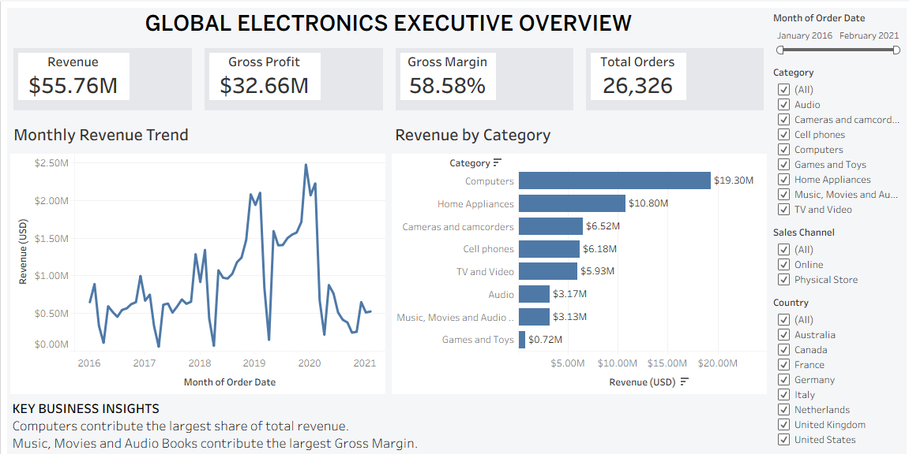
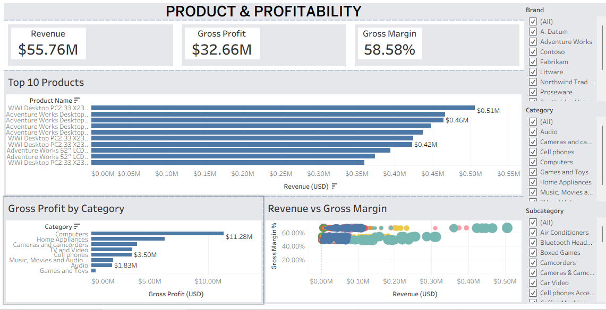
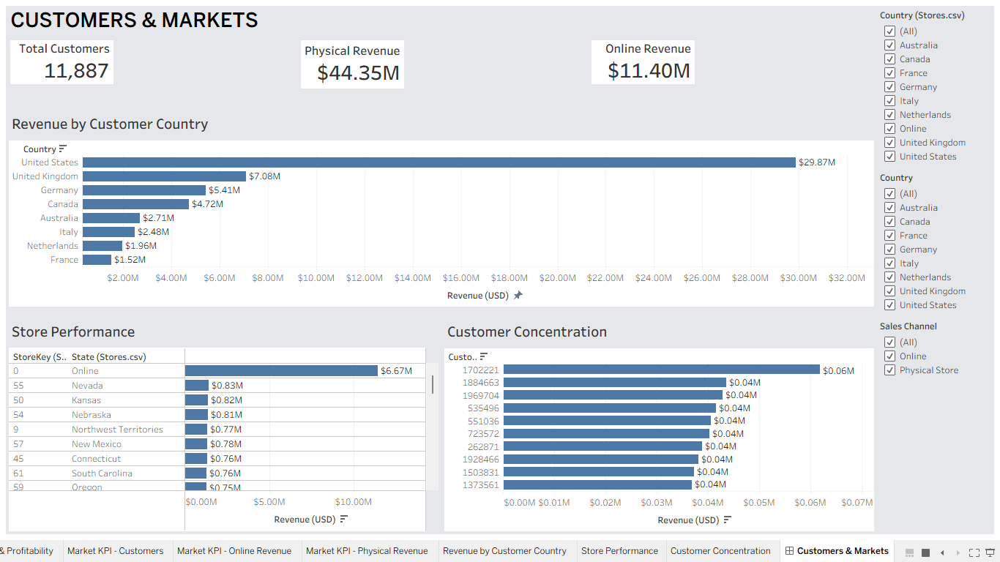

# Global Electronics Retail Performance Analysis

## Project Overview

This project analyzes a global electronics retailer's sales, products, customers, stores, and markets. The goal is to understand revenue and profitability trends, identify strong and weak-performing segments, compare online and physical-store performance, and provide evidence-based business recommendations.

Python is used for data cleaning, exploratory analysis, KPI calculation, and validation. Tableau is used to present the results through interactive dashboards.

## Business Objectives

- Analyze revenue, gross profit, orders, units, and trends over time.
- Identify leading product categories, brands, and products.
- Compare online and physical-store performance.
- Evaluate customer and geographic revenue distribution.
- Identify products with strong revenue and products with lower relative margins.
- Validate Tableau metrics against independent Python calculations.
- Develop practical recommendations supported by the available data.

## Tools and Technologies

- **Python:** pandas, NumPy
- **Visualization:** Matplotlib, Seaborn
- **Business intelligence:** Tableau
- **Data formats:** CSV, Jupyter Notebook, Tableau packaged workbook

## Dataset

The project uses the Global Electronics Retailer dataset. The main tables are:

| Table             | Purpose                                                                         |
| ----------------- | ------------------------------------------------------------------------------- |
| `Sales`           | Order lines, dates, quantities, customers, stores, products, and currency codes |
| `Products`        | Product names, categories, brands, listed prices, and listed costs              |
| `Customers`       | Customer demographics and geographic attributes                                 |
| `Stores`          | Store locations, size, opening date, and sales-channel information              |
| `Exchange_Rates`  | Daily exchange rates by currency                                                |
| `Data_Dictionary` | Field definitions and descriptions                                              |

The sales table is at **order-line grain**. One order can contain multiple products, so order counts use distinct order numbers rather than counting sales rows.

`StoreKey = 0` represents the online channel and is retained as a meaningful sales channel.

## Project Workflow

1. **Business understanding** — Define objectives, scope, KPIs, and business questions.
2. **Data inspection** — Review schemas, data types, missing values, duplicates, and key relationships.
3. **Data cleaning** — Standardize text fields, parse dates, convert product prices and costs to numeric values, and export cleaned CSV files.
4. **Metric preparation** — Join sales with product attributes and calculate revenue, COGS, gross profit, and gross margin.
5. **Exploratory analysis** — Analyze trends, categories, brands, products, stores, countries, and customers.
6. **Tableau development** — Build dashboards for executive, product, profitability, customer, and market analysis.
7. **Validation** — Compare Tableau results with Python-generated KPI and performance reports.
8. **Insights and recommendations** — Document findings, assumptions, limitations, and business actions.

## Key Metrics

- **Revenue:** Quantity × listed unit price in USD.
- **COGS:** Quantity × listed unit cost in USD.
- **Gross Profit:** Revenue − COGS.
- **Gross Margin %:** Gross Profit ÷ Revenue.
- **Distinct Orders:** Count of unique order numbers.
- **Units Sold:** Sum of sales quantities.
- **Average Order Value:** Revenue ÷ distinct orders.

These are analytical metrics based on listed product prices and costs. Gross profit is not net profit and excludes operating expenses, taxes, shipping, discounts, returns, and other adjustments unless represented in the source data.

## Validated KPI Summary

The current validation outputs report:

| Metric                    |          Value |
| ------------------------- | -------------: |
| Revenue                   | $55,755,479.59 |
| COGS                      | $23,092,791.21 |
| Gross Profit              | $32,662,688.38 |
| Gross Margin              |         58.58% |
| Distinct Orders           |         26,326 |
| Units Sold                |        197,757 |
| Average Order Value       |      $2,117.89 |
| Unmatched Product Records |              0 |

See [`reports/validation_results.csv`](reports/validation_results.csv) and [`reports/eda_kpi_summary.csv`](reports/eda_kpi_summary.csv).

## Tableau Dashboards

The packaged Tableau workbook is [`tableau/Global Electronics Retail Performance Analysis.twbx`](tableau/Global%20Electronics%20Retail%20Performance%20Analysis.twbx).

View the interactive dashboard on [Tableau Public](https://public.tableau.com/views/GlobalElectronicsRetailPerformanceAnalysis/ExecutiveOverview?:language=en-US&publish=yes&:display_count=n&:origin=viz_share_link).

### Executive Overview

Provides a high-level view of revenue, gross profit, gross margin, orders, and monthly revenue trends.

### Product & Profitability

Examines category, brand, and product performance, including gross profit and revenue-versus-margin comparisons.

### Customers & Markets

Explores customer geography, customer revenue concentration, online versus physical-store performance, and store results.

Dashboard screenshots are also available in [`tableau/screenshots/`](tableau/screenshots/).

## Key Findings

The documented analysis reports the following findings:

- Revenue increased through 2019 and declined substantially in 2020.
- Computers was the highest-revenue product category.
- Adventure Works was the leading brand in the generated brand report.
- The United States was the leading customer market in the country performance report.
- The online channel was a major contributor, generating approximately $11.40M in revenue.
- Product 444 was the highest gross-profit contributor among the displayed products.
- Several products had margins near 49%, below the overall gross margin of approximately 58.58%.
- The top 10% of active customers contributed approximately 35.98% of revenue.

Detailed evidence and recommendations are available in [`reports/phase_7_validation_and_insights.md`](reports/phase_7_validation_and_insights.md).

## Data Quality and Limitations

- The raw data contains 62,884 sales rows and 26,326 distinct orders.
- A large number of delivery dates are missing, particularly for online sales. Missing delivery dates were retained rather than removing the related sales.
- The observed order period is January 1, 2016 through February 20, 2021. The 2021 data is incomplete and should not be compared directly with complete years.
- Listed USD prices and costs may not equal realized transaction values.
- Gross profit is not net profit.
- Store revenue comparisons do not account for all operating costs, store size, foot traffic, or local demand.
- Some dimension records have no matching sales during the observed period.
- Exchange-rate data is available, but the exchange-rate direction and conversion treatment should be explicitly verified before using it to consolidate transaction currencies.
- The narrative findings and generated reports should be reconciled if conflicting totals appear under different filters or metric definitions.

## Repository Contents

- [`data/raw/`](data/raw/) — Original source CSV files.
- [`data/cleaned/`](data/cleaned/) — Cleaned CSV files used by the analysis.
- [`notebooks/01_data_cleaning.ipynb`](notebooks/01_data_cleaning.ipynb) — Data loading, cleaning, and quality checks.
- [`notebooks/02_exploratory_data_analysis.ipynb`](notebooks/02_exploratory_data_analysis.ipynb) — KPI and exploratory analysis.
- [`notebooks/03_validate_results.ipynb`](notebooks/03_validate_results.ipynb) — Validation calculations and outputs.
- [`reports/`](reports/) — KPI summaries, trends, performance reports, validation results, and documented insights.
- [`tableau/`](tableau/) — Tableau workbook and dashboard screenshots.

## How to Reproduce the Analysis

1. Install Python with Jupyter, pandas, NumPy, Matplotlib, and Seaborn.
2. Confirm that the source files are present in `data/raw/`.
3. Open and run [`notebooks/01_data_cleaning.ipynb`](notebooks/01_data_cleaning.ipynb).
4. Run [`notebooks/02_exploratory_data_analysis.ipynb`](notebooks/02_exploratory_data_analysis.ipynb).
5. Run [`notebooks/03_validate_results.ipynb`](notebooks/03_validate_results.ipynb).
6. Review the generated files in `reports/`.
7. Open the packaged Tableau workbook. If Tableau cannot locate its embedded or connected data, reconnect it to the cleaned files in `data/cleaned/`.
8. Compare Tableau dashboard values with the validation outputs.

The notebooks currently use relative paths such as `../data/cleaned`, so they should be run with the notebook directory as the working directory or with equivalent path configuration.

## Author

**Zohaib Khalid**  
BS Artificial Intelligence Student | COMSATS University

GitHub: [Zohaib Khalid](https://github.com/Zohaib-Khalid49)  
Tableau Public: [Interactive dashboard](https://public.tableau.com/views/GlobalElectronicsRetailPerformanceAnalysis/ExecutiveOverview?:language=en-US&publish=yes&:display_count=n&:origin=viz_share_link)
